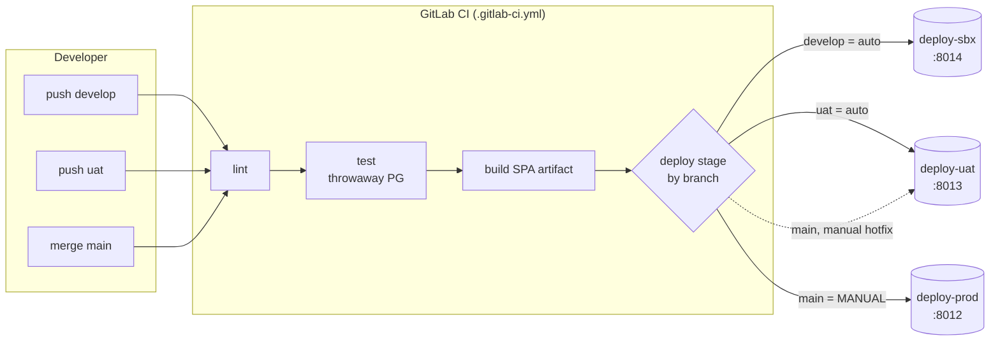
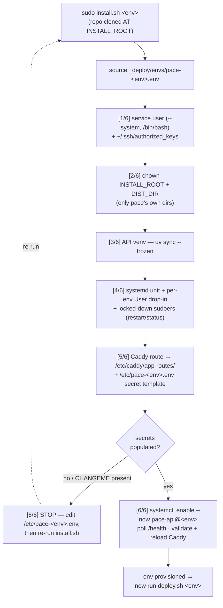
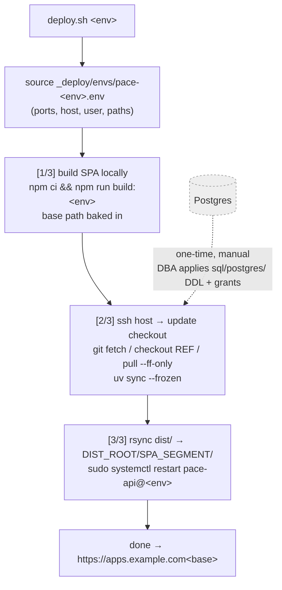
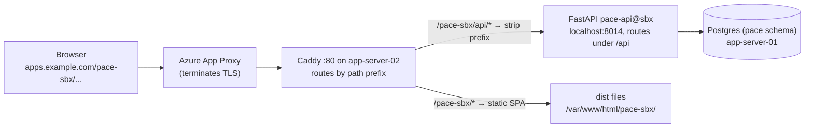

# Deploy architecture — pace-v0

High-level diagrams of how this app is provisioned, deployed, and served. For the
detailed runbook and the "why" behind each gotcha, see [README.md](README.md);
for CI wiring, [gitlab-setup.md](gitlab-setup.md).

The whole model in one sentence: **one Azure App Proxy → one Caddy on
`app-server-02`, environments distinguished by URL *path* (`/pace-sbx`,
`/pace-uat`, `/pace`), each backed by its own systemd API instance.**

---

## 1. CI/CD promotion model

Branch determines environment. SBX/UAT auto-deploy; PROD is a manual button. The
developer-side merges below are what **`/syn-promote-feature <sbx|uat|prod>`** automates.



| Branch | Env | Trigger |
|--------|-----|---------|
| `develop` | sbx | automatic on push |
| `uat` | uat | automatic on push (also manual on `main`) |
| `main` | prod | **manual button only** |

`lint`/`test`/`build` run on the `docker` runner; the deploy stages run on the
`shell` runner (needs `node`, `npm`, `uv`, `rsync`, `ssh`), delegating to
`_deploy/scripts/deploy.sh <env>`.

---

## 2. One-time host provisioning — `_deploy/scripts/install.sh <env>` (sudo, on `app-server-02`)

Idempotent. The **first run installs everything then STOPS** so you can fill in
the secret file; a **re-run** (once secrets are populated) enables + starts the
service.



### One-time human/infra steps (cannot come from this repo)

`install.sh` is run **by a human, with `sudo`, on the host** — CI never runs it
(CI only runs `deploy.sh`). Three infra steps can't be scripted from the repo, and
they **interleave** with `install.sh` rather than all coming after it:

| | Step | When, vs. `install.sh` |
|---|------|------------------------|
| **A** | Shared `/auth-callback/` (one-time per host) | **before** (precondition) |
| **B** | Token audience GUID | **nothing to do** — a built-in backend default |
| **C1** | Host → GitLab pull key | **after** |
| **C2** | CI runner → host key + CI vars | **after** (enables auto-deploy) |

<details>
<summary><b>Full checklist (replace <code>pace</code>/<code>&lt;env&gt;</code>; GUID is the shared registration's client ID)</b></summary>

**A. Shared `/auth-callback/`** — *Entra admin + host, ONCE per host (not per app).* Every
MSAL app logs in through one shared callback path, so Azure needs a **single** SPA redirect
URI for all apps and envs — and **adding a new app needs no Azure change**. On the shared
registration (`11111111-…`), add as **SPA**-type (⚠️ **trailing slash**, and set the same
value as the post-logout URI):
- `https://apps.example.com/auth-callback/`

This works because `localStorage` is keyed by origin (not path) and all apps share the one
client ID: the callback completes login for any app and bounces the browser back to where
it started. The host also serves the callback bundle at `/var/www/html/auth-callback/` via
a one-time Caddy fragment — see the toolkit's `auth-callback/` project (its `README.md` for
setup, `docs/MIGRATION.md` for moving existing per-path apps over). New scaffolded apps are
shared-callback by default (`frontend/src/authConfig.ts`).

**B. Token audience GUID** — *nothing to set.* The shared registration issues **v2.0**
tokens, so `aud` is the **client-ID GUID**, not the App ID URI:
- `AZURE_API_AUDIENCE` defaults to `11111111-1111-1111-1111-111111111111` (the frontend's
  `SPA_CLIENT_ID`) in `backend/app/core/config.py`; no env file sets it.
- Leave `AZURE_ISSUER` **unset** (the backend's v2.0 default already matches).
- (A `401 Invalid or expired token` right after login usually means one was overridden.)

**C1. Host → GitLab pull key** — *after provisioning; once per service user* (sbx uses
`synappssbx-pace`; uat+prod share `synapps-pace`):
```bash
sudo -u synappssbx-pace ssh-keygen -t ed25519 \
  -f /home/synappssbx-pace/.ssh/id_ed25519 -N "" -C "pace-host-pull@app-server-02"
sudo -u synappssbx-pace bash -c 'ssh-keyscan -H gitlab.example.com >> ~/.ssh/known_hosts'
sudo cat /home/synappssbx-pace/.ssh/id_ed25519.pub
# → GitLab → pace → Settings → Repository → Deploy keys → add, READ-ONLY
sudo -u synappssbx-pace git -C /opt/synveon/pace-sbx fetch   # verify, no prompt
```

**C2. CI runner → host key + CI variables** — *after provisioning; once per env:*
1. **Enable shared runners**: `platform` → CI/CD → Runners → uncheck "Lock to current
   projects" on `docker` + `shell`; then pace → enable both.
2. **Generate + authorize** (on runner host `ai-server-01`):
   ```bash
   sudo -u gitlab-runner ssh-keygen -t ed25519 \
     -f /home/gitlab-runner/.ssh/id_ed25519_pace_sbx -N "" -C "gitlab-ci-pace-sbx@ai-server-01"
   printf "echo '%s' | sudo tee -a /home/synappssbx-pace/.ssh/authorized_keys >/dev/null\n" \
     "$(sudo cat /home/gitlab-runner/.ssh/id_ed25519_pace_sbx.pub)"
   ```
   That prints the append command with the pubkey filled in: run the printed line as is
   **on lx02**, then verify:
   ```bash
   sudo -u gitlab-runner ssh -i /home/gitlab-runner/.ssh/id_ed25519_pace_sbx \
     -o BatchMode=yes synappssbx-pace@app-server-02 'echo ok=$(whoami)@$(hostname)'
   ```
3. **Set CI/CD variables** (pace → Settings → CI/CD → Variables):

   | Key | Value | Masked | Protected |
   |-----|-------|--------|-----------|
   | `SSH_KEY_SBX` | `base64 -w 0` of the sbx key | ✓ | ✗ |
   | `SSH_KEY_UAT` / `SSH_KEY_PROD` | base64 of each key | ✓ | ✓ (mark `uat`/`main` protected first) |
   | `SSH_KNOWN_HOSTS` | `ssh-keyscan -H ai-server-01 app-server-02` | ✗ | ✗ |
4. **Confirm the shell runner can build:** `sudo -u gitlab-runner bash -lc 'command -v node npm uv rsync ssh'`.

Full rationale + rotation runbook: [gitlab-setup.md](gitlab-setup.md).
</details>

---

## 3. One deploy run — `_deploy/scripts/deploy.sh <env>`

The runner (or a workstation) builds the SPA locally, then SSHes to the host.
**Deploys never touch the database.**



What this run does **not** do (deliberately):
- **DB schema** — one-time, per env: a DBA/owner applies the `backend/sql/postgres/` DDL +
  `999_grants.sql` (the app role has no DDL rights); `scripts.postgres.setup_db` only
  verifies readiness. See [README.md](README.md#database-setup-one-time-per-env).
- **Caddy / systemd config** — installed by `install.sh` (section 2), not CI.

---

## 4. Runtime request flow (what a deploy produces)

Environments differ by **URL path**, not hostname.



- Caddy **strips the env prefix** before proxying, so the backend always answers
  at `/api/*` (`backend/main.py` mounts there; `/health` is the root exception).
- The SPA is **built with its base path baked in**, so asset URLs, the API base, and
  the router `basename` all resolve under the env sub-path. (The MSAL `redirectUri` is
  the exception — it's the shared, path-independent `/auth-callback/`; see step A above.)
- `SPA_SEGMENT` is **not** `ENV_NAME`: prod's segment is `pace` (base `/pace/`),
  not `pace-prod`.

| Env | URL | API port |
|-----|-----|----------|
| sbx | `https://apps.example.com/pace-sbx/` | 8014 |
| uat | `https://apps.example.com/pace-uat/` | 8013 |
| prod | `https://apps.example.com/pace/` | 8012 |

> Ports must be unique on the shared host — confirm a free block with the platform owner.
